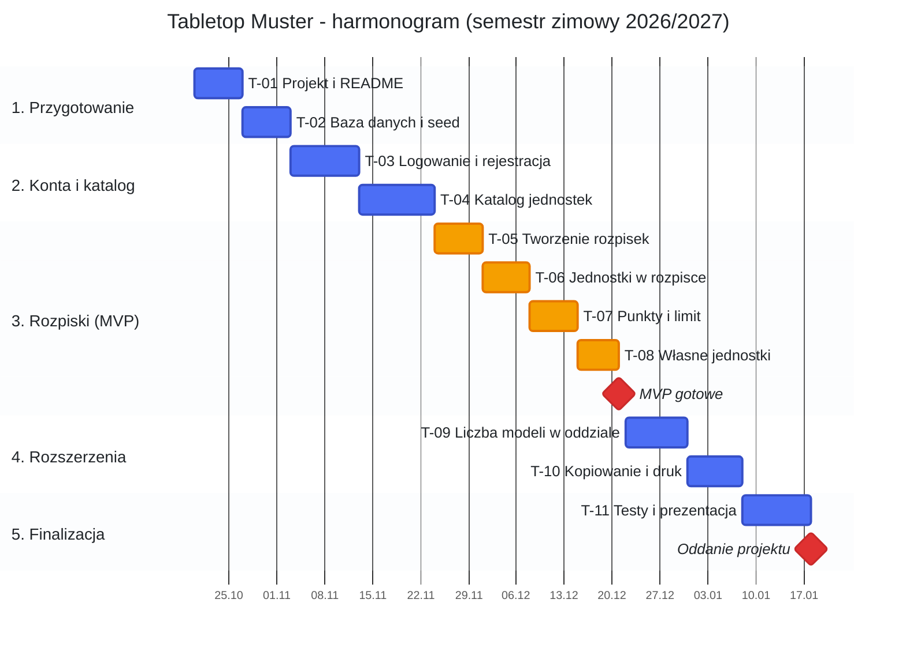

# Tabletop Muster — dokumentacja wstępna projektu

**Przedmiot:** Zespołowe Tworzenie Projektów IT
**Zespół:** Marcin Dziony, Przemysław Kowal
**Repozytorium:** [ProfGandalf/tabletop-muster](https://github.com/ProfGandalf/tabletop-muster)
**Wersja dokumentu:** 0.4

---

## 1. Wizja produktu

**Tabletop Muster** to aplikacja przeglądarkowa (strona internetowa) do tworzenia rozpisek armii do bitewnych gier figurkowych, inspirowana grą Warhammer 40,000. Gracz składa w niej armię z dostępnych jednostek, aplikacja na bieżąco liczy punkty i pilnuje ich limitu, a gracz może też dodawać własne jednostki.

**Problem:** gracze składają armie w arkuszach kalkulacyjnych albo na kartkach. Ręczne liczenie punktów prowadzi do błędów, a oficjalne aplikacje nie pozwalają dodawać własnych jednostek.

**Wizja w jednym zdaniu:**
> Dla graczy bitewnych gier figurkowych, którzy chcą szybko i bezbłędnie budować armie, Tabletop Muster jest prostym kreatorem rozpisek, który automatycznie liczy punkty i pozwala tworzyć własne jednostki.

## 2. Propozycja wartości (Value Proposition)

| Dla kogo | Problem | Co dajemy |
|---|---|---|
| Początkujący gracz | Myli się w liczeniu punktów | Automatyczne liczenie i ostrzeżenie o przekroczeniu limitu |
| Doświadczony gracz | Ma wiele rozpisek | Zapisywanie i kopiowanie rozpisek w jednym miejscu |
| Twórca homebrew | Brak narzędzia do własnych jednostek | Formularz własnych jednostek, które działają w rozpiskach jak każde inne |

**Unikalna wartość (UVP):** prosty, darmowy kreator armii z możliwością dodawania własnych jednostek.

## 3. Wymagania biznesowe

- **WB-01** Skrócić czas złożenia rozpiski na 2000 pkt do poniżej 10 minut.
- **WB-02** Wyeliminować błędy w liczeniu punktów.
- **WB-03** Umożliwić dodawanie własnych jednostek.
- **WB-04** Działać jako strona internetowa w przeglądarce, bez instalowania czegokolwiek przez użytkownika.
- **WB-05** Zerowe koszty: aplikacja jest hostowana na komputerze zespołu, wyłącznie w celu prezentacji działania.

## 4. User stories

Format: *Jako [rola], chcę [cel], aby [korzyść].* Priorytety: **M** = Must (MVP), **S** = Should, **C** = Could.

| ID | User story | Priorytet |
|---|---|---|
| US-01 | Jako gość chcę założyć konto, aby zapisywać swoje rozpiski. | M |
| US-02 | Jako użytkownik chcę się zalogować, aby mieć dostęp do swoich danych. | M |
| US-03 | Jako użytkownik chcę przeglądać frakcje i ich jednostki, aby wiedzieć, z czego mogę budować armię. | M |
| US-04 | Jako użytkownik chcę utworzyć rozpiskę z wybraną frakcją i limitem punktów, aby zacząć budować armię. | M |
| US-05 | Jako użytkownik chcę dodawać jednostki do rozpiski i je z niej usuwać, aby skomponować armię. | M |
| US-06 | Jako użytkownik chcę, aby suma punktów liczyła się automatycznie, aby nie liczyć ręcznie. | M |
| US-07 | Jako użytkownik chcę dostać ostrzeżenie po przekroczeniu limitu punktów, aby moja rozpiska była legalna. | M |
| US-08 | Jako użytkownik chcę dodać własną jednostkę, aby grać jednostkami spoza katalogu. | M |
| US-09 | Jako użytkownik chcę zapisywać rozpiski i do nich wracać, aby nie tracić pracy. | M |
| US-10 | Jako użytkownik chcę ustawić liczbę modeli w oddziale, aby rozpiska odpowiadała moim figurkom. | S |
| US-11 | Jako użytkownik chcę skopiować rozpiskę, aby szybko testować warianty. | S |
| US-12 | Jako użytkownik chcę wydrukować rozpiskę, aby zabrać ją na grę. | S |
| US-13 | Jako użytkownik chcę wyszukiwać jednostki po nazwie, aby szybciej je znajdować. | C |

### Kryteria akceptacji (kluczowe historie)

**US-06 — automatyczne liczenie punktów**
- Po dodaniu jednostki suma rośnie o jej koszt.
- Po usunięciu jednostki suma maleje o jej koszt.

**US-07 — ostrzeżenie o limicie**
- Gdy suma przekracza limit, wyświetla się komunikat z liczbą nadmiarowych punktów.

**US-08 — własna jednostka**
- Formularz wymaga podania nazwy, frakcji i kosztu punktowego.
- Zapisana jednostka jest dostępna przy dodawaniu do rozpisek tej frakcji.

## 5. MVP (Minimum Viable Product)

MVP to najmniejsza wersja aplikacji, która już rozwiązuje główny problem: pozwala złożyć rozpiskę z automatycznym liczeniem punktów i własnymi jednostkami.

**W MVP:** US-01 – US-09 (priorytet **M**)
**Poza MVP:** US-10 – US-13

**MVP jest gotowe, gdy:**
- użytkownik zakłada konto i się loguje,
- buduje i zapisuje rozpiskę, a punkty liczą się poprawnie,
- przekroczenie limitu jest sygnalizowane,
- może dodać własną jednostkę i użyć jej w rozpisce.

## 6. Zadania (backlog)

| ID | Zadanie | User story | Etap |
|---|---|---|---|
| T-01 | Założenie projektu ASP.NET Core Razor Pages, struktura katalogów, README z instrukcją uruchomienia | — | 1 |
| T-02 | Modele EF Core, migracje bazy SQLite + dane przykładowe (kilka frakcji i jednostek) | — | 1 |
| T-03 | Rejestracja, logowanie i wylogowanie (ASP.NET Core Identity) | US-01, US-02 | 2 |
| T-04 | Strona katalogu frakcji i jednostek | US-03 | 2 |
| T-05 | Tworzenie rozpiski i lista moich rozpisek | US-04, US-09 | 3 |
| T-06 | Dodawanie i usuwanie jednostek w rozpisce | US-05 | 3 |
| T-07 | Liczenie punktów i ostrzeżenie o limicie | US-06, US-07 | 3 |
| T-08 | Formularz własnej jednostki | US-08 | 3 |
| T-09 | Liczba modeli w oddziale | US-10 | 4 |
| T-10 | Kopiowanie rozpiski i widok do druku | US-11, US-12 | 4 |
| T-11 | Testy ręczne, poprawki, dokumentacja, prezentacja | — | 5 |

## 7. Wymagania niefunkcjonalne

- **WNF-01 Użyteczność:** interfejs jest czytelny na komputerze i telefonie (gotowy framework CSS).
- **WNF-02 Bezpieczeństwo:** hasła są przechowywane jako hash, a użytkownik widzi tylko własne rozpiski.
- **WNF-03 Prostota uruchomienia:** serwer uruchamia się jednym poleceniem (`dotnet run --urls http://0.0.0.0:5000`).
- **WNF-04 Wersjonowanie:** kod jest w repozytorium Git na GitHubie.
- **WNF-05 Kompatybilność:** strona działa w aktualnych wersjach Chrome, Firefox i Edge.

## 8. Stos technologiczny

| Warstwa | Technologia | Po co |
|---|---|---|
| Język | C# (.NET 8) | Jeden język do całej logiki aplikacji |
| Framework | ASP.NET Core Razor Pages | Strony HTML generowane po stronie serwera, bez osobnego frontendu |
| Widoki | Razor (`.cshtml`): HTML z wstawkami C# | Wyświetlanie danych i formularzy |
| Wygląd | Bootstrap (dołączony do szablonu projektu) | Ładny wygląd bez pisania CSS |
| Skrypty | JavaScript (opcjonalnie) | Drobne usprawnienia interfejsu, np. potwierdzenie usunięcia |
| Baza danych | SQLite + Entity Framework Core | Baza w jednym pliku, obsługa przez klasy C# zamiast ręcznego SQL |
| Logowanie | ASP.NET Core Identity | Gotowa rejestracja, logowanie i hashowanie haseł |
| Zarządzanie projektem | GitHub (Issues, Projects, Milestones, Pull Requests) | Całe zarządzanie projektem w jednym miejscu |

## 9. Model danych

- **User**: id, nazwa, hash hasła
- **Faction**: id, nazwa
- **Unit**: id, frakcja, nazwa, koszt, statystyki (tekst), autor (puste = jednostka bazowa)
- **ArmyList**: id, użytkownik, frakcja, nazwa, limit punktów
- **ArmyListEntry**: id, rozpiska, jednostka, liczba modeli

## 10. Harmonogram produkcji

Jak czytać wykres: niebieskie paski to zwykłe zadania, pomarańczowe to te, bez których nie ma MVP, a czerwone romby oznaczają najważniejsze momenty projektu, czyli gotowe MVP i oddanie.

| Etap | Okres | Zadania | Kamień milowy |
|---|---|---|---|
| 1. Przygotowanie | 20.10 – 02.11.2026 | T-01 – T-02 | Projekt uruchamia się lokalnie |
| 2. Konta i katalog | 03.11 – 23.11.2026 | T-03 – T-04 | Logowanie i katalog jednostek |
| 3. Rozpiski (MVP) | 24.11 – 21.12.2026 | T-05 – T-08 | **MVP gotowe (21.12.2026)** |
| 4. Rozszerzenia | 22.12.2026 – 07.01.2027 | T-09 – T-10 | Pełna wersja |
| 5. Finalizacja | 08.01 – 17.01.2027 | T-11 | **Oddanie projektu (18.01.2027)** |
