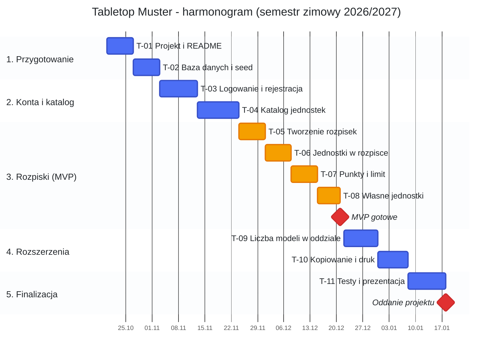

# Tabletop Muster — harmonogram produkcji

Jak czytać wykres: niebieskie paski to zwykłe zadania, pomarańczowe to te, bez których nie ma MVP, a czerwone romby oznaczają najważniejsze momenty projektu, czyli gotowe MVP i oddanie.

| Etap | Okres | Zadania | Kamień milowy |
|---|---|---|---|
| 1. Przygotowanie | 20.10 – 02.11.2026 | T-01 – T-02 | Projekt uruchamia się lokalnie |
| 2. Konta i katalog | 03.11 – 23.11.2026 | T-03 – T-04 | Logowanie i katalog jednostek |
| 3. Rozpiski (MVP) | 24.11 – 21.12.2026 | T-05 – T-08 | **MVP gotowe (21.12.2026)** |
| 4. Rozszerzenia | 22.12.2026 – 07.01.2027 | T-09 – T-10 | Pełna wersja |
| 5. Finalizacja | 08.01 – 17.01.2027 | T-11 | **Oddanie projektu (18.01.2027)** |
